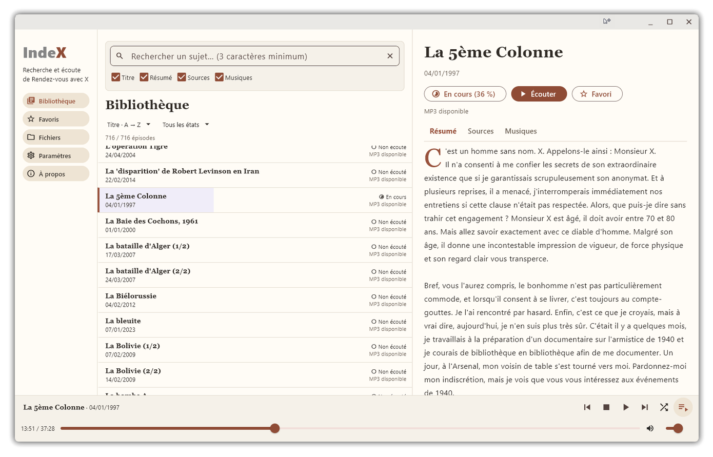

<div align="center">


<p><strong>Rechercher, explorer et écouter les épisodes de l'émission Rendez-vous avec X sur Windows et Android.</strong></p>

<p>
  <a href="https://github.com/Yavuplogu/IndeX/releases"><strong>Télécharger</strong></a> ·
  <a href="#prise-en-main">Prise en main</a> ·
  <a href="#fonctionnalités">Fonctionnalités</a> ·
  <a href="https://github.com/Yavuplogu/IndeX/issues">Signaler un problème</a>
</p>



</div>

<h1>IndeX</h1>

J’ai construit IndeX à partir d’une interrogation : serait-il possible de disposer d’un outil entièrement hors ligne permettant de gérer et d’écouter ma collection d’épisodes de Rendez-vous avec X ?

Cela faisait des années que l’idée me séduisait, en réalité depuis l’arrêt de l’émission en 2015. Puis, la mort de Patrick Pesnot en 2023 m’a remotivé et j’ai fait quelques tentatives, plutôt infructueuses, car je ne suis pas du tout développeur.

Il y a quelque temps, j’ai eu l’idée d’utiliser l’IA en me disant : « Bon, à mon avis, ça va me prendre quelques mois et j’aurai probablement un résultat nébuleux, fonctionnant à moitié, puis je tenterai à nouveau ma chance dans dix ans. »

Finalement, le développement n’a duré qu’une semaine, pour un résultat parfaitement fonctionnel. Certes, il y a eu beaucoup de va-et-vient, pas mal de versions différentes et quelques adaptations, mais tout le processus a été beaucoup plus rapide et intuitif que prévu. C’est à la fois fascinant et terrifiant pour l’avenir.

Quoi qu’il en soit, vous trouverez un peu plus bas un tour d’horizon des capacités de IndeX.

Bonne écoute,

Monsieur K.

> **Version bêta · série 0.9** — Disponible pour Windows et Android. Aucun MP3
> n’est embarqué dans les applications. La version de départ `0.9.0` est affichée
> `0.9.00` ; chaque construction réserve ensuite le mineur suivant.

## Télécharger

Les versions publiées sont disponibles dans les **[Releases](https://github.com/Yavuplogu/IndeX/releases)**.
Choisissez le fichier correspondant à votre plateforme :

| Plateforme | Distribution | Configuration minimale |
| --- | --- | --- |
| **Windows** | Archive portable `.zip`, sans installateur | Windows 10 ou 11 · x64 |
| **Android** | Application `.apk` | Android 7 ou supérieur · ARM64 |

## Fonctionnalités

IndeX rassemble le catalogue documentaire de **716 émissions**, représentant environ
**420 heures d’écoute**, dans une interface claire. Consultez les résumés, retrouvez
les références et écoutez vos MP3 en local depuis une même application.

Le catalogue est intégré : il reste entièrement consultable **sans MP3 et hors ligne**. 
Si vous avez déjà un dossier personnel rempli d'épisodes, ils seront associés au catalogue 
et disponible pour l'écoute, sinon un bouton permet le téléchargement des MP3 à la demande.

- **Explorer** : Recherche dans les titres, résumés, sources et musiques ; tris, filtres et favoris.
- **Comprendre** : Fiches documentaires avec résumés, références, musiques et accès aux épisodes connexes.
- **Associer** : Reconnaissance automatique des noms de MP3, associations manuelles et diagnostic du dossier.
- **Écouter** : Lecture, pause, arrêt, volume, déplacement dans la piste et sauts de dix secondes ; modes aléatoire et enchaînement.
- **Reprendre** : Progression sauvegardée localement, reprise d’écoute et états d'écoute.
- **Transférer** : Export/import des données via un fichier entre Windows et Android, avec aperçu et résolution des conflits avant fusion.
- **Compléter** : Téléchargement à la demande d’un MP3 absent (sur http://rendezvousavecmrx.free.fr/) lorsqu’une URL est disponible dans le catalogue.
- **Organiser** : Suppression optionnelle des MP3 écoutés en conservant le suivi et les favoris ; renommage facultatif des MP3 sur Windows.
- **Personnaliser** : Thèmes clair et sombre ; interface Android adaptée au portrait et au paysage.


## Prise en main

### Windows

1. Télécharger et décompresser le dossier "IndeX" dans n'importe quel emplacement.
2. Lancer **`IndeX.exe`**.
3. Choisir le dossier contenant les MP3, ou commencer sans fichiers audio.

Le dossier `IndeX/user` est proposé par défaut pour vos données (favoris, états d'écoute, progression...) ; 
cet emplacement reste modifiable.

### Android

1. Télécharger puis installer l’APK.
2. Autoriser l’installation depuis cette source si Android le demande.
3. Choisir le dossier contenant les MP3, ou commencer sans fichiers audio.

Pour les mises à jour Android, installer le nouvel APK officiel **sans désinstaller
IndeX**, afin de conserver les données.

## Gestion des fichiers MP3

Si vous disposez déjà d'épisodes au format MP3, l'application va scanner le dossier défini
et associera automatiquement les fichiers en prenant en compte uniquement ces deux formatages :

```text
1997-01-04 La 5ème Colonne.mp3
```
Ou son équivalent :

```text
mr_x_1997_01_04.mp3
```

Aucun autre type de formatage de nom n'est accepté, simplement car ces deux types sont les catalogues
les plus répandus sur Internet. Les autres noms peuvent être associés manuellement. **Le scan ne modifie pas les
fichiers locaux.**

Le renommage de fichiers, disponible uniquement sur Windows, convertit les noms de type "mr_x_1997_01_04.mp3" vers
son équivalent "1997-01-04 La 5ème Colonne.mp3". Il est facultatif et nécessite un aperçu puis
une confirmation.

La suppression des MP3 écoutés afin de libérer de la place est possible sur Windows et Android depuis
**Paramètres → Fichiers audio**, avec aperçu et confirmation. Le suivi et les
favoris sont conservés. **La suppression peut être définitive, sans passage par
une corbeille.**

Le catalogue, la recherche et l’écoute de fichiers locaux fonctionnent **hors
ligne**. Aucun compte n’est requis et aucune synchronisation automatique n’est
effectuée. Si un MP3 est téléchargé via rendezvousavecmrx.free.fr, la lecture se fait 
à partir du fichier téléchargé, et non depuis le site (ce n'est pas du streaming audio).


## Remarques

Cette application a été réalisée entièrement avec une IA. Je n'ai aucune compétence en développement et le code doit
donc être assez bordélique aux yeux d'un professionnel. C'est néanmoins largement suffisant car j'ai construit
IndeX pour mon usage personnel, avec l'idée de partager le résultat s'il s’avérait à la hauteur de mes
propres standards d'utilisation. J'ai veillé à ce que IndeX fonctionne entièrement hors ligne, il n'y a
aucune télémétrie, aucune dépendance externe ou aucun appel à un serveur quelconque (sauf évidemment pour le 
téléchargement optionnel de MP3).

Pour signaler un problème ou proposer une amélioration, utilisez les
**[Issues](https://github.com/Yavuplogu/IndeX/issues)**. Précisez la version d’IndeX,
votre système et les étapes permettant de reproduire le problème. Notez que je ne compte
pas réaliser un suivi acharné de cette application et je peux décider ou non de corriger
ou d'ajouter ce que vous souhaitez. IndeX étant totalement open source, vous pouvez d'ailleurs
cloner ce repository et développer directement vos propres améliorations si je suis trop lent à réagir. 
Rappelez-vous que j'ai tout fait avec une IA, ce n'est donc pas très compliqué.

IndeX est développé avec **Flutter et Dart**, avec un cœur partagé entre Windows
et Android. Les scripts de construction et de vérification se trouvent dans
[`tools/`](tools/). Les workflows GitHub Actions se lancent manuellement.


## Licence

Le code original d’IndeX est distribué sous **GNU GPL v3 uniquement**
(`GPL-3.0-only`).

Consultez [LICENSE](LICENSE) et [LICENSE_SCOPE.md](LICENSE_SCOPE.md) pour le texte et
son périmètre. Cette licence du code ne s’applique pas aux MP3, à la documentation
ni aux contenus documentaires. Les composants tiers conservent leurs propres
licences.
